<!-- Please do not change this html logo with link -->

<a target="_blank" href="https://www.microchip.com/" id="top-of-page">
   <picture>
      <source media="(prefers-color-scheme: light)" srcset="images/mchp_logo_light.png" width="350">
      <source media="(prefers-color-scheme: dark)" srcset="images/mchp_logo_dark.png" width="350">
      
   </picture>
</a>

# Curiosity Nano Out-of-the-Box — Use Case for CLB Using the PIC16F13145 Microcontroller With MCC Melody

This repository provides an MPLAB® X project that comes preloaded on the PIC16F13145 Curiosity Nano Evaluation Kit when the user first plugs it in. It consists of a state machine demonstration of the Configurable Logic Block (CLB) peripheral that controls the behavior and/or brightness of the on-board LED.

## Related Documentation

More details and code examples on the PIC16F13145 can be found at the following links:

- [PIC16F13145 Product Page](https://www.microchip.com/en-us/product/PIC16F13145?utm_source=GitHub&utm_medium=TextLink&utm_campaign=MCU8_MMTCha_PIC16F13145&utm_content=pic16f13145-cnano-out-of-box-code-mplab-mcc-github&utm_bu=MCU08)
- [PIC16F13145 Code Examples on Discover](https://mplab-discover.microchip.com/v2?dsl=PIC16F13145)
- [PIC16F13145 Code Examples on GitHub](https://github.com/microchip-pic-avr-examples/?q=PIC16F13145)
- [CLB Peripheral Page](https://www.microchip.com/en-us/products/microcontrollers-and-microprocessors/8-bit-mcus/core-independent-and-analog-peripherals/system-flexibility/configurable-logic-block?utm_source=GitHub&utm_medium=TextLink&utm_campaign=MCU8_MMTCha_PIC16F13145&utm_content=pic16f13145-cnano-out-of-box-code-mplab-mcc-github&utm_bu=MCU08)
- [Online, Standalone CLB Configuration Tool](https://logic.microchip.com/clbsynthesizer/)

## Software Used

- [MPLAB® X IDE v6.30.0 or newer](https://www.microchip.com/en-us/tools-resources/develop/mplab-x-ide?utm_source=GitHub&utm_medium=TextLink&utm_campaign=MCU8_MMTCha_PIC16F13145&utm_content=pic16f13145-cnano-out-of-box-code-mplab-mcc-github&utm_bu=MCU08) or [MPLAB® Tools for VS Code®](https://www.microchip.com/en-us/tools-resources/develop/mplab-tools-vs-code?utm_source=GitHub&utm_medium=TextLink&utm_campaign=MCU8_MMTCha_PIC16F13145&utm_content=pic16f13145-cnano-out-of-box-code-mplab-mcc-github&utm_bu=MCU08)
- [MPLAB® XC8 v3.10.0 or newer ](https://www.microchip.com/en-us/tools-resources/develop/mplab-xc-compilers?utm_source=GitHub&utm_medium=TextLink&utm_campaign=MCU8_MMTCha_PIC16F13145&utm_content=pic16f13145-cnano-out-of-box-code-mplab-mcc-github&utm_bu=MCU08)
- [PIC16F1xxxx_DFP v1.29.444 or newer](https://packs.download.microchip.com/)

**Important:** The current version features an update to the CLB peripheral, which now includes the CLB Synthesizer Library. For migration details and required changes, refer to the [_Troubleshooting MCC Melody Configurable Logic Block (CLB) Projects Configured With CLB v1.x.x_](https://onlinedocs.microchip.com/oxy/GUID-9438FEC3-C80B-4328-8A8E-2531EDEE6155-en-US-1/index.html) migration guide documentation.

## Hardware Used

- The [PIC16F13145 Curiosity Nano Development board](https://www.microchip.com/en-us/development-tool/EV06M52A?utm_source=GitHub&utm_medium=TextLink&utm_campaign=MCU8_MMTCha_PIC16F13145&utm_content=pic16f13145-cnano-out-of-box-code-mplab-mcc-github&utm_bu=MCU08) is used as a test platform:
   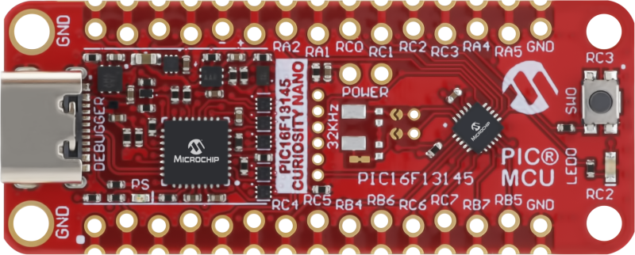

## Operation

To program the Curiosity Nano board with this MPLAB X project, follow the steps provided in the [How to Program the Curiosity Nano Board](#how-to-program-the-curiosity-nano-board) chapter.  

## Concept

The CLB peripheral on the PIC16F13145 acts as a button debouncer and state machine for the LED. On power-up, the LED blinks at (nominally) 7.8 Hz. All other states of the state machine change the brightness of the LED via Pulse Width Modulation (PWM) dimming, which is synthesized inside the CLB as well. The pushbutton, SW0, on the Curiosity Nano is debounced within the CLB and used to advance the state machine. The table below shows the behavior for each button press. The CLB circuit is presented in the image below:
 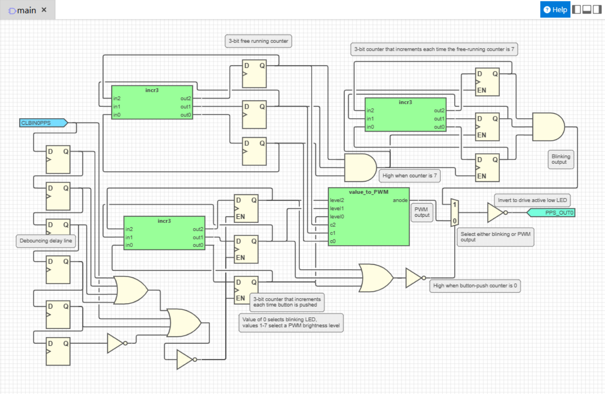

| State | LED Behavior                          |
| ----- | ------------------------------------- |
| 0     | The LED blinks at (nominally) 7.8 Hz. |
| 1     | Brightness Level 1 (12.5%)            |
| 2     | Brightness Level 2 (25%)              |
| 3     | Brightness Level 3 (37.5%)            |
| 4     | Brightness Level 4 (50%)              |
| 5     | Brightness Level 5 (62.5%)            |
| 6     | Brightness Level 6 (75%)              |
| 7     | Brightness Level 7 (87.5%)            |

**Note:** Percentages are with respect to active LOW.

## Setup

The following peripheral and clock configurations are set up using the MPLAB Code Configurator (MCC) Melody for the PIC16F13145:

1. Configuration Bits:
   - CONFIG1:
     - External Oscillator mode selection bits: Oscillator not enabled
     - Power-up default value for COSC bits: HFINTOSC (1MHz)
     - VDD Range Analog Calibration Selection bit: Internal analog systems are calibrated for operation between VDD = 1.8 - 3.6V
        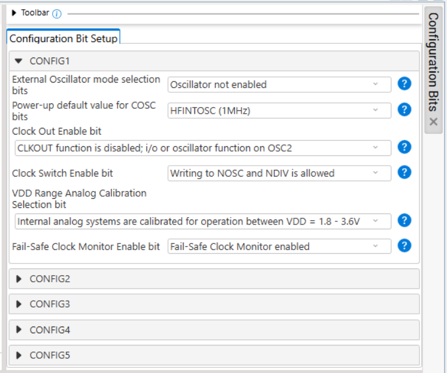
   - CONFIG3:
     - WDT operating mode: WDT Disabled, SEN is ignored
        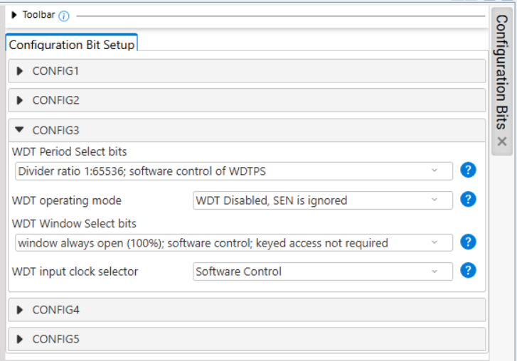

2. CLB Synthesizer Library:
   - Enable CLB: Enabled
   - Clock Selection: MFINTOSC-32
   - Clock Divider: Divide clock source by 64
      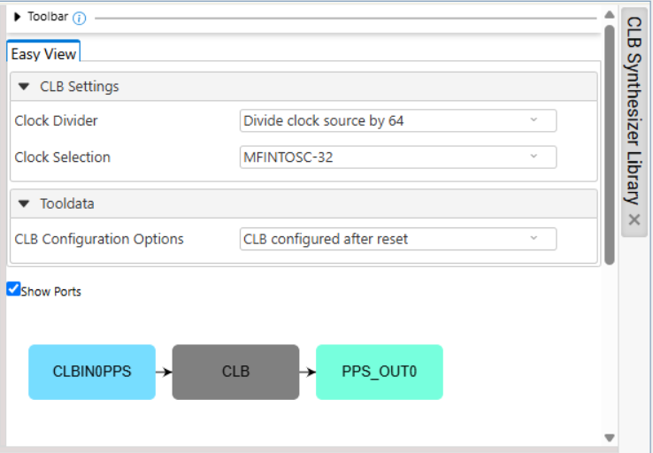

3. CRC:
   - Auto-configured by CLB

4. Pin Grid View:
   - CLBPPSOUT0: RC2 (LED)
   - CLBIN0PPS: RC3 (SW0 - requires Weak Pull-Up (WPU) enable)
      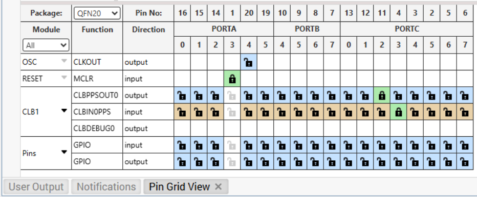

## Demo

In the demo below, each press of the SW0 button advances the state machine, changing the behavior or brightness of the on-board LED on the Curiosity Nano board.

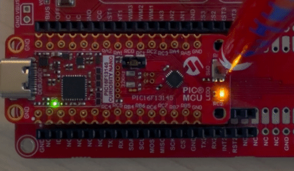

## Summary

The CLB peripheral on the PIC16F13145 manages button debouncing and LED state control, including PWM dimming, for the Curiosity Nano kit. The preloaded project demonstrates these features through a state machine that changes the LED’s behavior with each button press.

 

## How to Program the Curiosity Nano Board

This chapter demonstrates how to use the MPLAB X IDE to program a PIC® device with an Example_Project.X. This is applicable to other projects.

1.  Connect the board to the PC.

2.  Open the `Example_Project.X` project in MPLAB X IDE.

3.  Set the `Example_Project.X` project as main project.
     Right click the project in the **Projects** tab and click **Set as Main Project**.
     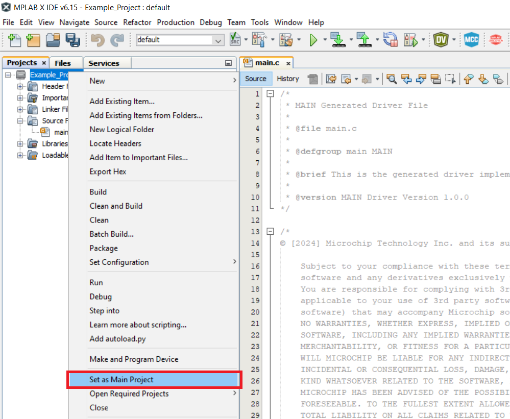

4.  Clean and build the `Example_Project.X` project.
     Right click the `Example_Project.X` project and select **Clean and Build**.
     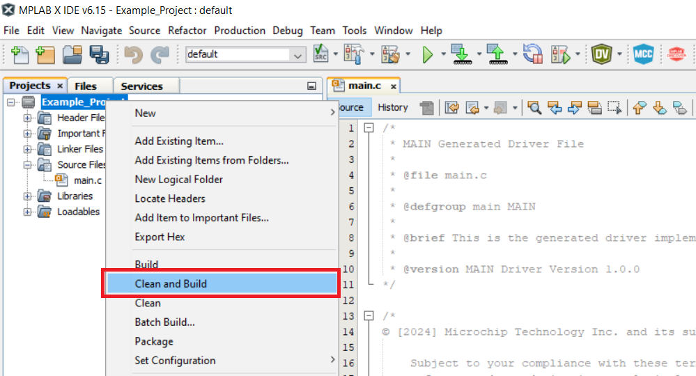

5.  Select **PICxxxxx Curiosity Nano** in the Connected Hardware Tool section of the project settings:
     Right click the project and click **Properties**.
     Click the arrow under the Connected Hardware Tool.
     Select **PICxxxxx Curiosity Nano** (click the **SN**), click **Apply** and then click **OK**:
     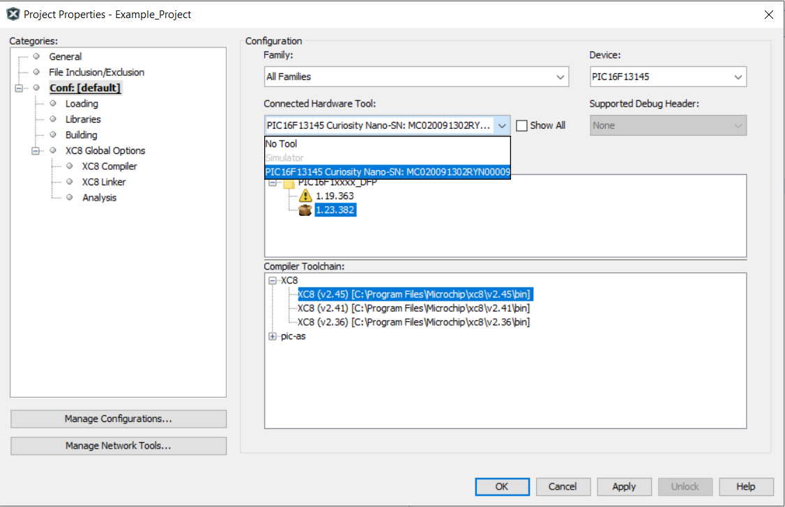

6.  Program the project to the board.
     Right click the project and click **Make and Program Device**.
     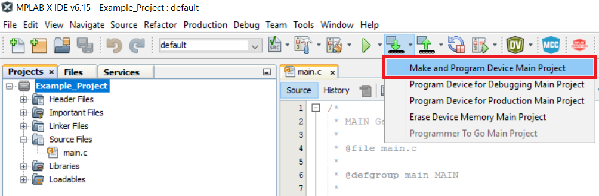

 

---

## Menu

- [Back to Top](#curiosity-nano-out-of-the-box--use-case-for-clb-using-the-pic16f13145-microcontroller-with-mcc-melody)
- [Back to Related Documentation](#related-documentation)
- [Back to Software Used](#software-used)
- [Back to Hardware Used](#hardware-used)
- [Back to Operation](#operation)
- [Back to Concept](#concept)
- [Back to Setup](#setup)
- [Back to Demo](#demo)
- [Back to Summary](#summary)
- [Back to How to Program the Curiosity Nano Board](#how-to-program-the-curiosity-nano-board)
